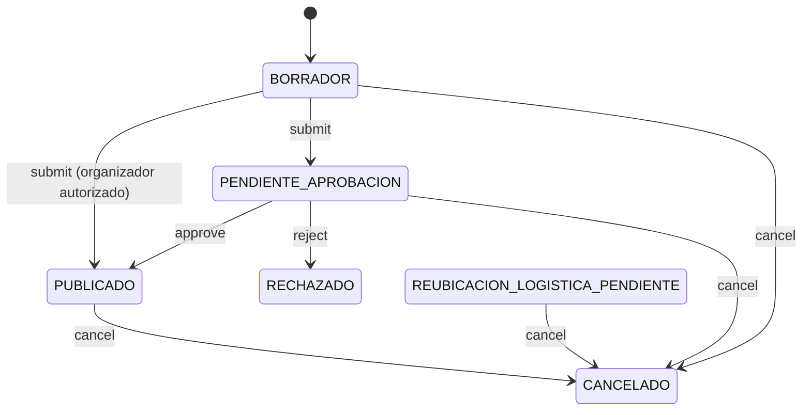

# ECI-MyCampus — Microservicio de Eventos & Radar (Events Service)

Microservicio responsable del radar de eventos en vivo, cálculo de estados temporales, máquina de estados de aprobación/moderación, control transaccional de cupos concurrentes, denuncias y notificaciones.

## Tecnologías
* **Runtime:** Node.js 20+ / TypeScript (strict)
* **Framework HTTP:** Fastify 5 + `fastify-type-provider-zod`
* **Validación y contratos:** Zod (entrada, salida y OpenAPI)
* **ORM:** Prisma ORM — PostgreSQL (`events_schema`)
* **Correos transaccionales:** Resend (vía `IEmailAdapter`)
* **Pruebas:** Vitest + cobertura v8 (umbral 85 %)

## Arquitectura

Sigue la guía de arquitectura backend del equipo (`DTO <-> Domain <-> Entity`, controladores delgados, validación en dos niveles, manejo centralizado de errores e inyección por constructor).

```text
src/
├── adapters/            # Puertos (IEmailAdapter) y adaptadores (Resend, Console)
├── config/              # Variables de entorno validadas con Zod (fail-fast)
├── controllers/         # Controladores delgados (sin try/catch ni lógica de negocio)
│   └── docs/            # Contratos *Api: schemas de entrada/salida + OpenAPI
├── exceptions/          # Jerarquía única de excepciones + GlobalErrorHandler
├── listeners/           # Observer: publicador de eventos de dominio y listeners
├── mappers/             # EventMapper (DTO <-> Domain) y EventEntityMapper (Domain <-> Prisma)
├── models/
│   ├── domain/          # Entidad rica Event, enums y tipos de dominio (sin Prisma/Fastify)
│   │   ├── events/      # Eventos de dominio
│   │   └── state/       # Patrón State Deny-by-Default + factory
│   └── dto/
│       ├── request/     # Esquemas Zod de entrada (.strict() contra mass assignment)
│       └── response/    # Contratos de salida + ErrorResponseDTO
├── repositories/        # Interfaces I*Repository
│   ├── prisma/          # Implementaciones Prisma (reserva atómica de cupos)
│   └── spec/            # EventSpecs: predicados dinámicos componibles
├── routes/              # Endpoint + contrato + guard RBAC + handler
├── security/            # Autenticación JWT opcional, requireAuth, requireRoles
├── services/            # IEventsService
│   ├── impl/            # EventsServiceImpl (orquestación)
│   └── notification/    # Strategy + Factory de canales de notificación
├── utils/
├── validators/          # IEventValidator + impl (reglas de negocio)
├── app.ts               # buildApp(): ensambla Fastify (testeable sin abrir puerto)
├── container.ts         # Composition root (única instanciación de implementaciones)
└── server.ts            # Arranque y apagado ordenado
```

### Ciclo de vida del evento



Cualquier transición no listada responde `422 Unprocessable Entity`.

## Endpoints (`/api/v1/events`)

| Método | Ruta | Acceso | Descripción |
| :--- | :--- | :--- | :--- |
| GET | `/radar` | Público | Eventos publicados en curso y próximos (filtros: `category`, `facultyId`, `date`, `limit`) |
| GET | `/:id` | Público* | Detalle (*no publicados solo para organizador/moderación) |
| POST | `/` | ESTUDIANTE, DOCENTE, ENTRENADOR, MODERADOR, ADMIN | Solicitar o publicar un evento |
| PATCH | `/:id/approve` | MODERADOR, ADMIN | Aprobar evento pendiente |
| PATCH | `/:id/reject` | MODERADOR, ADMIN | Rechazar con motivo |
| PATCH | `/:id/cancel` | Organizador o moderación | Cancelar evento |
| POST | `/:id/register` | Autenticado | Inscripción atómica con control de cupos |
| POST | `/:id/reports` | Autenticado | Denunciar un evento |

* `GET /health` — estado del servicio.
* `GET /docs` — documentación OpenAPI interactiva (Swagger UI).

### Formato de error

Todas las respuestas de error siguen el mismo contrato:

```json
{ "status": 422, "error": "Unprocessable Entity", "mensaje": "...", "path": "/api/v1/events/..", "timestamp": "..." }
```

| Código | Cuándo |
| :---: | :--- |
| 400 | Datos malformados (incluye `detalles` por campo) |
| 401 | Sin token o token inválido |
| 403 | Rol sin permisos |
| 404 | Evento inexistente |
| 409 | Inscripción/denuncia duplicada o cupos agotados |
| 422 | Regla de negocio o transición de estado inválida |
| 500 | Error inesperado (mensaje genérico, detalle solo en logs) |

## Ejecución local

```bash
cp .env.example .env
npm install
npm run prisma:generate
npm run dev            # http://localhost:4003  ·  docs en /docs
```

## Calidad

```bash
npm run typecheck      # tsc estricto (src + tests)
npm test               # pruebas unitarias y web (AAA)
npm run test:coverage  # con umbral mínimo de cobertura
```
