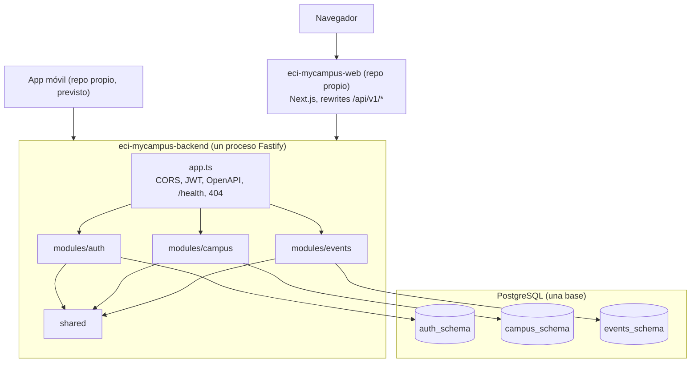
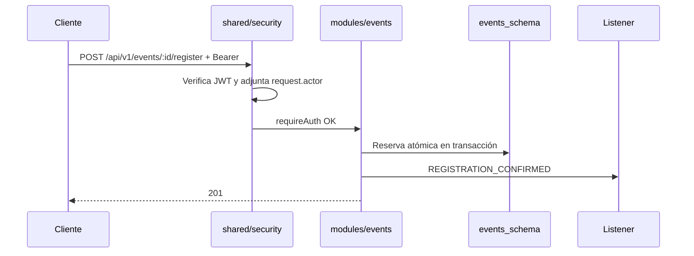

# Arquitectura: monolito modular

Un solo proceso de backend desplegable, con módulos independientes a nivel lógico. El motivo y las alternativas descartadas están en [`ARCHITECTURE_DECISIONS.md`](./ARCHITECTURE_DECISIONS.md).

## Diagrama



## Estructura

```text
src/
├── server.ts              # Arranque y apagado ordenado
├── app.ts                 # buildApp(): plugins transversales y registro de módulos
├── container.ts           # Composition root: único lugar que conecta implementaciones
├── config/env.ts          # Variables de entorno, validadas al arrancar
├── shared/                # Núcleo sin lógica de negocio
│   ├── database/          # Fábrica de PrismaClient
│   ├── errors/            # Excepciones, ErrorResponseDTO y manejador de errores
│   ├── http/              # Contrato AppModule
│   ├── security/          # Identidad: roles, Actor, claims JWT y guards
│   └── utils/             # Logger
└── modules/
    ├── auth/
    ├── campus/
    └── events/
```

Cada módulo mantiene las capas que ya tenía su servicio: `controllers`, `mappers`, `models`, `repositories`, `routes`, `services` y, si aplica, `validators`, `adapters` y `listeners`. El código se movió sin reescribirlo.

Cada módulo expone **un único punto de entrada**, `modules/<nombre>/index.ts`.

## Responsabilidades

| Módulo | Responsabilidad | Tablas (esquema) | No hace |
| :--- | :--- | :--- | :--- |
| `auth` | Registro, credenciales, emisión de JWT, perfil, auditoría | `users`, `user_profiles`, `audit_logs` (`auth_schema`) | Decidir permisos de otros módulos |
| `campus` | Catálogo de edificios, facultades, escenarios y servicios | `universities`, `faculties`, `buildings`, `campus_places`, `sports_facilities`, `campus_services` (`campus_schema`) | Conocer eventos o usuarios |
| `events` | Radar, ciclo de vida, moderación, cupos, denuncias, notificaciones | `events`, `event_registrations`, `event_reports`, `event_favorites` (`events_schema`) | Validar credenciales |
| `shared` | Infraestructura y contratos transversales | Ninguna | Reglas de negocio |

## Dependencias permitidas

| Desde | Puede importar |
| :--- | :--- |
| `modules/X/**` | Sus propios archivos, `shared/**`, `config/env` (solo tipos) y `modules/Y/index.ts` |
| `shared/**` | `shared/**` y `config/env` (solo tipos). **Nunca** `modules/**` |
| `app.ts`, `container.ts`, `server.ts` | Todo, a través de `modules/*/index.ts` |
| `modules/X/models/domain/**` | Solo el propio dominio y `shared/security`. Nunca Fastify ni Prisma |

`tests/architecture/module-boundaries.test.ts` hace cumplir estas reglas: una importación ilegal rompe la suite. Hoy ningún módulo importa a otro.

## Comunicación entre módulos

1. **Sin red.** Cuando un módulo necesite a otro, invoca una interfaz publicada en el `index.ts` del otro, inyectada por constructor en `container.ts`. Nunca accede a su repositorio ni a sus tablas.
2. **Identidad por contrato.** `auth` firma con el tipo `JwtClaims` de `shared/security`, y el guard valida con ese mismo contrato. Los demás módulos solo ven `request.actor`.
3. **Efectos secundarios por eventos de dominio.** `events` publica en un publicador en memoria y sus listeners envían notificaciones. Si otro módulo los necesitara, se suscribiría desde `container.ts`.



## Persistencia

- **Una base PostgreSQL y un `PrismaClient`** compartido, creado en `container.ts`.
- **Un esquema PostgreSQL por módulo**, igual que hasta ahora, y un archivo Prisma por módulo en `prisma/schema/`.
- **Sin claves foráneas entre esquemas.** Las referencias como `Event.buildingId` siguen siendo lógicas: mantienen los módulos separables.
- **Migraciones centralizadas** en `prisma/schema/migrations`, un único historial. Prisma exige que estén junto al archivo del datasource.
- **Una transacción no cruza módulos.** Si algún caso de uso lo necesitara, se debe tratar como una decisión explícita y registrarla.

## Configuración

`config/env.ts` es el único lector de `process.env`. Valida con Zod y falla al arrancar si algo es inválido. Las variables están en `.env.example`.

Los módulos reciben por constructor solo lo que necesitan: nunca leen el entorno ni reciben la configuración completa si no la usan.

## Contratos externos

Se conservan rutas, códigos, cuerpos y mensajes bajo `/api/v1/*`. Para mantener los mensajes exactos de cada servicio, el manejador de errores es uno solo pero recibe los textos propios de cada módulo.

**Cambios inevitables y justificados** (ningún cliente del repo los usa):

| Antes | Ahora | Motivo |
| :--- | :--- | :--- |
| Tres `/health` en los puertos 4001, 4002 y 4003, con `service: <nombre>` | Un `/health` en el puerto 4000 con `service: "eci-mycampus-backend"` | Hay un solo proceso |
| Tres `/docs` | Un `/docs` con todos los endpoints | Hay un solo proceso |

## Pruebas

| Nivel | Ubicación | Base de datos | Qué valida |
| :--- | :--- | :--- | :--- |
| Unitario | `tests/<módulo>/unit` | No | Dominio, servicios, validadores |
| Web | `tests/<módulo>/web` | No, con repositorios en memoria | Endpoints, guards, contratos, errores |
| Arquitectura | `tests/architecture` | No | Límites entre módulos |
| Integración | `tests/integration` | **Sí**, se omite sin `TEST_DATABASE_URL` | Consultas reales y concurrencia de cupos |

## Clientes

La API es el contrato común. La web llega por rewrites de Next.js; la app móvil, cliente principal previsto, llamará directamente a `/api/v1/*` con tokens Bearer (ADR-008). Por eso el backend debe poder exponerse públicamente sin depender de la web, y las protecciones de borde como el límite de intentos deben vivir en él.

## Evolución futura

Si un módulo llegara a necesitar escalar por separado, la extracción es directa: sus tablas ya están aisladas en un esquema, no tiene claves foráneas externas y sus dependencias pasan por interfaces. Bastaría con reemplazar la implementación local por un cliente HTTP en `container.ts`. No hay ninguna necesidad actual que lo justifique.
