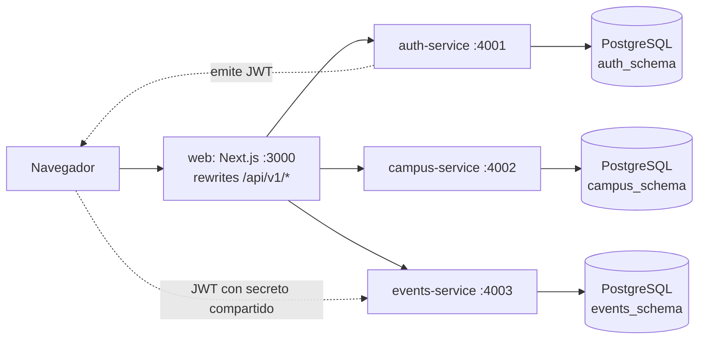

# Auditoría del proyecto ECI-MyCampus

- **Fecha:** 2026-11-04
- **Alcance:** repos `eci-mycampus-auth-service`, `eci-mycampus-campus-service`, `eci-mycampus-events-service`, `eci-mycampus-web` y carpeta local `eci-mycampus-starter`.
- **Estado auditado:** rama `main` de este repositorio, que importa los tres servicios sin modificarlos, y rama `main` de `eci-mycampus-web`.
- **Método:** lectura de código, configuración y documentación, y ejecución real de typecheck, pruebas, cobertura, `prisma validate`, `next build` y `npm audit`.
- **No verificable en la máquina de auditoría:** imágenes Docker (Docker no está instalado) ni despliegues reales.

Severidades: **CRITICAL** compromete funcionamiento, seguridad o integridad; **HIGH** debe corregirse; **MEDIUM** mejora relevante; **LOW** calidad o mantenimiento.

## 1. Resumen ejecutivo

El backend tiene una base técnica sólida: TypeScript estricto, capas bien separadas, 100 pruebas en verde y una reserva de cupos atómica. El problema no es la calidad interna, sino el costo operativo de una arquitectura que no aporta beneficios a un equipo de dos personas.

**Hallazgo central: los "microservicios" ya funcionan como módulos.** No hay ninguna llamada HTTP ni mensajería entre servicios, comparten la misma base de datos PostgreSQL (un esquema por servicio) y el mismo secreto JWT. Esto hace que la consolidación sea de bajo riesgo: no hay que reemplazar comunicación remota, sino unir tres procesos casi idénticos.

Los problemas más graves son ajenos a la arquitectura:

1. Vulnerabilidades críticas en las dependencias que firman y verifican JWT y en Next.js.
2. Una clave privada de Firebase en una carpeta sincronizada con OneDrive.
3. El frontend no compila, no tiene lockfile y su imagen Docker no puede construirse.
4. No hay migraciones, CI ni entorno reproducible: el sistema no se puede levantar desde cero.
5. El registro acepta cualquier correo institucional sin verificar que pertenezca a quien se registra.

### Línea base medida

| Componente | Typecheck | Pruebas | Cobertura (líneas) | `npm audit --omit=dev` |
| :--- | :--- | :--- | :--- | :--- |
| auth-service | OK | 23 OK | 96,18 % | 11: 2 críticas, 6 altas, 3 moderadas |
| campus-service | OK | 15 OK | 91,06 % | 9: 6 altas, 3 moderadas |
| events-service | OK | 62 OK | Sin error de umbral | 15: 2 críticas, 6 altas, 3 moderadas, 4 bajas |
| web | **Falla** (2 errores) | **Sin pruebas** (`vitest` sale con código 1) | No aplica | 4: 1 crítica, 3 altas |

`next build` falla y `next lint` no es utilizable porque ESLint no está configurado: abre un asistente interactivo. Los umbrales de cobertura excluyen repositorios Prisma, contenedores y adaptadores, así que **ninguna prueba toca una base de datos real**.

## 2. Arquitectura actual



| Servicio | Responsabilidad | Endpoints bajo `/api/v1` | Tablas |
| :--- | :--- | :--- | :--- |
| auth | Registro, login, perfil, auditoría | `auth/register`, `auth/login`, `auth/me` | `users`, `user_profiles`, `audit_logs` |
| campus | Catálogo de solo lectura | `campus/buildings`, `campus/buildings/:id`, `campus/faculties`, `campus/sports` | `universities`, `faculties`, `buildings`, `campus_places`, `sports_facilities`, `campus_services` |
| events | Radar, moderación, cupos, denuncias, notificaciones | `events/radar`, `events/:id`, `events`, `events/:id/{approve,reject,cancel,register,reports}` | `events`, `event_registrations`, `event_reports`, `event_favorites` |
| web | Interfaz y proxy | Rewrites hacia los tres servicios | Ninguna |

Cada servicio expone además `GET /health` y `GET /docs`.

**Acoplamientos reales entre servicios:**

- **Contrato JWT:** auth firma los claims y events los valida con su propio esquema Zod y una copia de los roles.
- **Referencias lógicas sin integridad:** `Event.buildingId`, `Event.facultyId`, `Event.organizerId` y `UserProfile.facultyId` son texto libre. Nadie comprueba que existan.
- **Código copiado:** ver la sección 9.

## 3. Estructura del proyecto

```text
ECI-MyCampus/
├── eci-mycampus-auth-service/    # Repo Git propio (40 archivos)
├── eci-mycampus-campus-service/  # Repo Git propio (37 archivos)
├── eci-mycampus-events-service/  # Repo Git propio (59 archivos)
├── eci-mycampus-web/             # Repo Git propio (23 archivos)
└── eci-mycampus-starter/         # Prototipo Expo + Firebase, sin Git
```

Cada servicio repite la misma estructura interna: `config`, `controllers`, `exceptions`, `lib`, `mappers`, `models`, `repositories`, `routes`, `services`, `validators`, `app.ts`, `container.ts` y `server.ts`.

**Infraestructura inexistente:** no hay `docker-compose`, CI/CD, migraciones Prisma, seeds ni ESLint en ningún repo.

## 4. Fortalezas

Se conservan todas en la nueva arquitectura.

- TypeScript estricto y contratos Zod en entrada, salida y OpenAPI.
- Separación `DTO <-> Domain <-> Entity` con mappers explícitos. El dominio no importa Prisma ni Fastify.
- Controladores delgados, composition root e inyección por constructor.
- Patrón State deny-by-default para el ciclo de vida del evento.
- Reserva de cupos en una sola sentencia `UPDATE ... WHERE available_capacity > 0`, dentro de una transacción.
- Contrato de error único (`ErrorResponseDTO`) y manejador global que no filtra detalles internos.
- Argon2id para contraseñas y `.strict()` contra asignación masiva.
- Configuración validada al arrancar y `buildApp()` testeable sin abrir puerto.
- Historial Git con commits atómicos y sin secretos: la búsqueda de `.env`, claves y patrones de tokens en todo el historial no encontró nada.

## 5. Debilidades

- Tres procesos, tres `package.json`, tres Dockerfiles y tres conjuntos de dependencias para desplegar lo que ya es un solo sistema.
- Cuatro repos para dos desarrolladores: un cambio de contrato puede exigir hasta cuatro commits sin atomicidad.
- Frontend mayormente de maqueta, desconectado de la API.
- Capacidades modeladas pero sin acceso funcional (sección 6, H-09 y M-07).
- Ninguna verificación automática: sin CI, sin integración con base de datos y sin pruebas en web.

## 6. Problemas técnicos

| ID | Severidad | Hallazgo | Evidencia |
| :--- | :--- | :--- | :--- |
| C-01 | CRITICAL | Clave privada de cuenta de servicio de Firebase en disco, dentro de una carpeta de OneDrive. No está en ningún historial Git. No se pudo comprobar si sigue activa. | `eci-mycampus-starter/eci-mycampus/eci-seed/serviceAccountKey.json.json` (campos `private_key`, `client_email`; valores no leídos) |
| C-02 | CRITICAL | Vulnerabilidades críticas en la verificación de JWT, de la que depende toda la autorización. | `npm audit`: `@fastify/jwt <=9.1.0` y `fast-jwt <=6.3.3` en auth y events |
| C-03 | CRITICAL | Vulnerabilidad crítica en la versión fijada de Next.js. | `npm audit` en web; `next` fijado en `15.1.7` |
| H-01 | HIGH | Secreto JWT de desarrollo público como valor por defecto. `NODE_ENV` por defecto es `development`, así que un despliegue sin esa variable usa un secreto conocido y permite falsificar un token `ADMIN`. El Dockerfile fija `NODE_ENV=production`, lo que mitiga el caso Docker pero no otros. | `src/config/env.ts` de auth y events |
| H-02 | HIGH | El registro valida el dominio del correo pero no su propiedad: nadie verifica el correo. `isEmailVerified` nunca pasa a `true` ni se comprueba en login. Cualquiera puede registrarse con el correo de otra persona. | `auth.mapper.ts`, `auth.service.impl.ts` |
| H-03 | HIGH | Login y registro sin límite de intentos, lo que permite fuerza bruta. | Ningún rate limit en `app.ts` |
| H-04 | HIGH | El frontend no compila: `totalCapacity` no existe en `CampusEvent`. | `eci-mycampus-web/src/app/page.tsx:43,64`; `next build` falla |
| H-05 | HIGH | La imagen de web no se puede construir: usa `npm ci` y no hay `package-lock.json`. | `eci-mycampus-web/Dockerfile` |
| H-06 | HIGH | Las URL de los rewrites se resuelven al compilar en Next.js, y el Dockerfile no las pasa en esa etapa. El contenedor apuntaría a `localhost`. Deducido del comportamiento documentado de Next.js; no probado por falta de Docker. | `eci-mycampus-web/next.config.ts`, `eci-mycampus-web/Dockerfile` |
| H-07 | HIGH | No hay migraciones ni seeds. El sistema no se puede levantar de forma reproducible y los catálogos quedan vacíos. | `prisma/` solo contiene `schema.prisma` |
| H-08 | HIGH | Ninguna prueba ejecuta consultas reales. La reserva atómica de cupos, núcleo del negocio, nunca se ha probado contra PostgreSQL. | `vitest.config.ts` excluye `repositories/prisma/**` |
| H-09 | HIGH | No hay forma de crear un `MODERADOR` o `ADMIN` ni de marcar `isAuthorizedOrganizer`. El registro siempre asigna `ESTUDIANTE`, así que la moderación solo es alcanzable editando la base de datos. | `auth.mapper.ts`; no hay endpoints de roles ni seed |
| H-10 | HIGH | Sin CI: nada impide integrar código que no compile, como ocurrió con H-04. | No hay `.github/workflows` |
| H-11 | HIGH | Dependencias con vulnerabilidades altas: `zod <4.6.6`, `fastify-type-provider-zod <=4.0.2`, `@fastify/static`, `prisma` (cadena `@prisma/config`). | `npm audit` |
| M-01 | MEDIUM | Sin `CORS_ORIGIN`, CORS refleja cualquier origen con `credentials: true`. El riesgo real es limitado porque la API usa tokens Bearer y no cookies. | `corsOrigin: ... : true` |
| M-02 | MEDIUM | Tokens de 7 días sin revocación. Un usuario desactivado o degradado conserva sus permisos hasta que caduque el token, y `/me` no comprueba `isActive`. | `auth.controller.ts`, `auth.guard.ts` |
| M-03 | MEDIUM | Los eventos se crean sin validar que `buildingId` y `facultyId` existan. | `event.validator.impl.ts` |
| M-04 | MEDIUM | `AuditLog.actorId` es obligatorio pero la relación usa `onDelete: SetNull`. Prisma lo advierte; borrar un usuario con auditoría fallaría. | `prisma validate`; `auth/prisma/schema.prisma` |
| M-05 | MEDIUM | Sin cabeceras de seguridad (helmet). | `app.ts` |
| M-06 | MEDIUM | Los fallos de auditoría se descartan en silencio con `.catch(() => {})`: se pierde el registro sin dejar rastro. | `auth.service.impl.ts` |
| M-07 | MEDIUM | Funcionalidad modelada sin acceso: cancelar inscripción (y por tanto reactivarla y devolver el cupo), favoritos, resolución de denuncias, estados `REUBICACION_LOGISTICA_PENDIENTE` y `ARCHIVADO`. | `schema.prisma`, `events.routes.ts`, `event-states.ts` |
| M-08 | MEDIUM | Web sin conexión real: `lib/api.ts` no se usa, la portada muestra `DEMO_EVENTS`, y `/login`, `/mis-eventos` y `/perfil` son enlaces a páginas inexistentes. | `eci-mycampus-web/src/app/page.tsx`, `Navbar.tsx`, `BottomNav.tsx` |
| M-09 | MEDIUM | Sin ESLint en ningún paquete. | `next lint` abre un asistente; los servicios no tienen linter |
| M-10 | MEDIUM | El script `test` de web siempre falla al no haber pruebas. | `vitest` sale con código 1 |
| L-01 | LOW | Las notificaciones de dominio son en memoria y se pierden si el proceso se reinicia. Aceptable a esta escala; conviene saberlo. | `domain-event-publisher.ts` |
| L-02 | LOW | Login responde antes si el correo no existe, lo que abre una posible enumeración por tiempo. | `auth.service.impl.ts` |
| L-03 | LOW | `previewFeatures = ["multiSchema"]` está obsoleto en la versión instalada. | `prisma validate` |
| L-04 | LOW | La comprobación del dominio del correo distingue mayúsculas; `X@ESCUELAING.EDU.CO` se rechaza aunque luego se normaliza. | `auth.request.dto.ts` |
| L-05 | LOW | `/docs` queda público en producción. Puede ser intencional. | `app.ts` |

## 7. Problemas arquitectónicos

| ID | Severidad | Hallazgo |
| :--- | :--- | :--- |
| A-01 | HIGH | La arquitectura no aporta los beneficios de los microservicios. No hay despliegue ni base de datos ni escalado independientes en la práctica: comparten PostgreSQL y secreto. Sí se paga todo su costo: tres procesos, tres pipelines potenciales y tres dependencias que actualizar. |
| A-02 | MEDIUM | Polirepo sin un punto de integración. Los tres servicios se consolidan en un repo. Backend y frontend siguen separados por decisión del equipo (ADR-002), así que un cambio de contrato requiere dos commits coordinados; el contrato OpenAPI en `/docs` es la referencia común. |
| A-03 | MEDIUM | El contrato JWT se duplica: auth lo firma y events lo revalida con su propia copia de roles. Un cambio en auth rompe events sin que ninguna prueba lo detecte. |
| A-04 | LOW | Los proxys de Next añaden un salto. Se mantienen porque evitan CORS y ocultan la API interna. |

## 8. Problemas documentales

| ID | Severidad | Hallazgo | Estado real |
| :--- | :--- | :--- | :--- |
| D-01 | HIGH | No hay documentación de sistema: ningún documento explica cómo se relacionan los cuatro repos ni cómo levantarlos juntos. | Solo READMEs por servicio |
| D-02 | MEDIUM | El código y dos READMEs citan una "guía de arquitectura backend" (`GUIA_BACKEND §6`) que no está en ningún repo. | Referencia rota |
| D-03 | MEDIUM | `eci-mycampus-web/README` describe `features/` y rutas de Eventos, Lugares y Admin que no existen. | Solo `/` y `/mapa` |
| D-04 | MEDIUM | `eci-mycampus-web/README` documenta `NEXT_PUBLIC_*_SERVICE_URL`; el código usa `INTERNAL_*_SERVICE_URL`. | Seguir el README deja la configuración sin efecto |
| D-05 | MEDIUM | `eci-mycampus-web/README` llama "BFF" y "Gateway" a simples rewrites. | No hay lógica de agregación |
| D-06 | MEDIUM | Los READMEs de ejecución local omiten crear la base de datos y aplicar el esquema, y no mencionan un PostgreSQL necesario. | `npm run dev` arranca pero falla en la primera consulta |
| D-07 | MEDIUM | El README de auth afirma "gestión de roles RBAC"; solo existe el enum y la emisión del claim. | Ver H-09 |
| D-08 | LOW | Las tablas de endpoints listan `/health` y `/docs` bajo `/api/v1/*`. | Están en la raíz |
| D-09 | LOW | El README de events afirma pruebas "con umbral", cierto, pero no aclara que excluyen la persistencia. | Ver H-08 |
| D-10 | LOW | `campus/.env.example` declara `JWT_SECRET`, que ese servicio no usa. | Variable sin efecto |
| D-11 | LOW | `RecoverPasswordRequestSchema` sugiere recuperación de contraseña, que no existe. | DTO sin uso |

**Documentación correcta y verificada:** endpoints, formato de error, matriz de códigos HTTP y diagrama de estados del README de events; estructura de carpetas de los tres servicios.

## 9. Código duplicado o innecesario

| Elemento | Copias | Situación |
| :--- | :--- | :--- |
| `lib/prisma.ts` | 3 | Idénticos |
| `models/dto/response/error.response.dto.ts` | 3 | Idénticos |
| `exceptions/app.exception.ts` | 3 | Casi idénticos; cambian los mensajes por defecto y `InvalidStateException` |
| `exceptions/global-error-handler.ts` | 3 | Idéntica lógica; cambian mensajes de `P2002` y de validación |
| `config/env.ts`, `app.ts`, `server.ts` | 3 | Misma estructura con variaciones menores |
| `Dockerfile`, `tsconfig*.json`, `.gitignore` | 3 | Solo cambia el puerto |

**Sin uso:** `RecoverPasswordRequestSchema`; `eci-mycampus-web/src/lib/api.ts` (se conserva, es el cliente que deberá conectarse).

**Prototipo:** `eci-mycampus-starter` (Expo + Firebase) está fuera de la arquitectura actual. No se importa ni se modifica. Decidir su destino corresponde al equipo, después de resolver C-01.

## 10. Riesgos técnicos

| Riesgo | Impacto | Mitigación |
| :--- | :--- | :--- |
| Migraciones contra una base existente de la que no hay registro | Alto | Migración inicial idempotente en contenido y procedimiento `migrate resolve` documentado. Revisar si existe alguna base real antes de aplicar. |
| Cambios mayores de `zod` y `@fastify/*` alteran el contrato | Medio | Rama propia y suite completa antes de integrar |
| Conservar respuestas exactas al unificar el manejador de errores | Medio | Mensajes configurables por módulo y pruebas existentes sin cambios |
| Sin Docker en la máquina de verificación | Medio | Dockerfile y compose quedan marcados como no probados hasta correrlos con Docker |
| Módulos que se acoplen con el tiempo | Medio | Prueba automática de límites entre módulos |

## 11. Recomendaciones priorizadas

1. **Inmediato, a cargo del equipo:** revocar la clave de C-01 si sigue activa.
2. **Actualizar dependencias vulnerables** (C-02, C-03, H-11).
3. **Consolidar en monolito modular** (A-01, A-02, A-03) conservando los contratos.
4. **Cerrar la configuración insegura** (H-01, M-01).
5. **Reproducibilidad:** migraciones, compose y CI (H-07, H-10).
6. **Reparar web** (H-04, H-05, H-06).
7. **Prueba de integración real** de la reserva de cupos (H-08).
8. **Decisiones de producto para el siguiente ciclo:** verificación de correo y rate limit (H-02, H-03), gestión de roles (H-09), conexión real del frontend (M-08), funcionalidad sin acceso (M-07).

## 12. Plan de migración a monolito modular

Diseño completo en [`docs/architecture/MODULAR_MONOLITH.md`](../architecture/MODULAR_MONOLITH.md). Cada feature es una rama hacia `develop` de su repo, mantiene el repositorio funcional y se valida con typecheck y suite completa. F9 ocurre en `eci-mycampus-web`; todas las demás, en `eci-mycampus-backend`. Los servicios aún no migrados siguen funcionando en `services/` hasta su turno.

### F1. `refactor/modular-monolith-structure`

- **Objetivo:** crear el monolito en la raíz del repo con su núcleo compartido, configuración central y esquema Prisma por módulo.
- **Alcance:** `package.json`, `tsconfig`, `vitest`, `src/shared`, `src/config`, `src/app.ts`, `src/server.ts`, `prisma/schema/`.
- **Dependencias:** ninguna.
- **Riesgos:** diferencias de mensajes de error entre servicios.
- **Aceptación:** `api` compila y responde `/health`; el manejador produce respuestas idénticas a las actuales.
- **Pruebas:** unitarias de configuración y núcleo compartido.

### F2. `refactor/consolidate-campus-module`

- **Objetivo:** mover campus a `src/modules/campus` con `git mv`. Se empieza por él porque es de solo lectura.
- **Archivos:** `services/campus-service/**` hacia `src/modules/campus/**` y `tests/campus/**`.
- **Dependencias:** F1.
- **Riesgos:** rutas de importación.
- **Aceptación:** las 15 pruebas siguen pasando con las mismas aserciones de contrato; se retira `services/campus-service`.
- **Pruebas:** suite de campus.

### F3. `refactor/consolidate-auth-module`

- **Objetivo:** mover auth y compartir el contrato de identidad.
- **Archivos:** `services/auth-service/**`, `src/shared/security`.
- **Dependencias:** F1.
- **Riesgos:** `/me` conserva su mensaje 401 propio.
- **Aceptación:** las 23 pruebas siguen pasando; se retira `services/auth-service`.
- **Pruebas:** suite de auth.

### F4. `refactor/consolidate-events-module`

- **Objetivo:** mover events, el módulo más grande, sobre el guard compartido.
- **Archivos:** `services/events-service/**`.
- **Dependencias:** F1 y F3.
- **Riesgos:** dependencias opcionales de correo (Resend) y logger de Fastify.
- **Aceptación:** las 62 pruebas siguen pasando; se retira `services/events-service`.
- **Pruebas:** suite de events.

### F5. `feature/module-boundaries`

- **Objetivo:** impedir por prueba automática las importaciones ilegales entre módulos y fijar el contrato de identidad.
- **Dependencias:** F2, F3 y F4.
- **Riesgos:** falsos positivos.
- **Aceptación:** la prueba falla ante una importación ilegal y pasa con el código actual. No añade dependencias.
- **Pruebas:** la propia prueba de límites y una de token auth-a-events.

### F6. `fix/environment-security`

- **Objetivo:** cerrar H-01 y M-01.
- **Archivos:** `src/config/env.ts`, `.env.example`.
- **Dependencias:** F1.
- **Riesgos:** los entornos sin `JWT_SECRET` dejan de arrancar, lo cual es intencional y se documenta.
- **Aceptación:** sin secreto no arranca fuera de pruebas.
- **Pruebas:** unitarias de configuración.

### F7. `fix/dependency-security`

- **Objetivo:** cerrar C-02 y H-11.
- **Archivos:** `package.json`, lockfile y código afectado por cambios mayores.
- **Dependencias:** F4.
- **Riesgos:** rupturas de API en Zod 4.
- **Aceptación:** sin vulnerabilidades críticas ni altas de producción, o justificadas una a una; suite verde.
- **Pruebas:** suite completa.

### F8. `feature/database-migrations`

- **Objetivo:** cerrar H-07 (migraciones) y M-04, y validar contra PostgreSQL real.
- **Archivos:** `prisma/migrations/**`, `prisma/schema/auth.prisma`.
- **Dependencias:** F4.
- **Riesgos:** bases ya existentes (sección 10).
- **Aceptación:** la migración se aplica desde cero; `prisma validate` sin advertencias.
- **Pruebas:** aplicación real y prueba de integración de reserva (H-08).

### F9. `fix/web-build-and-proxy` (repo `eci-mycampus-web`)

- **Objetivo:** cerrar C-03, H-04, H-05, H-06 y M-10, y apuntar a una única API.
- **Archivos:** `web/**`.
- **Dependencias:** F4.
- **Riesgos:** cambio de versión de Next.
- **Aceptación:** `next build` y typecheck en verde; lockfile presente.
- **Pruebas:** build y typecheck.

### F10. `refactor/single-deployment`

- **Objetivo:** un solo Dockerfile de backend, `docker-compose` y CI (H-10).
- **Archivos:** `Dockerfile`, `docker-compose.yml`, `.github/workflows/ci.yml`.
- **Dependencias:** F8 y F9.
- **Riesgos:** no ejecutable sin Docker en la máquina de verificación.
- **Aceptación:** los comandos del CI pasan en local; las imágenes quedan marcadas como no probadas si no hay Docker.
- **Pruebas:** comandos del CI.

### F11. `docs/final-documentation`

- **Objetivo:** cerrar los hallazgos D-01 a D-11 y registrar las decisiones.
- **Archivos:** `README.md`, `eci-mycampus-web/README.md`, `docs/architecture/ARCHITECTURE_DECISIONS.md`.
- **Dependencias:** todas.
- **Riesgos:** ninguno técnico.
- **Aceptación:** una persona nueva puede levantar el proyecto siguiendo solo el README.
- **Pruebas:** seguir el procedimiento documentado desde cero.

**Fuera de este plan, sin eliminar nada:** verificación de correo, rate limit, gestión de roles, funcionalidad de M-07 y conexión real del frontend. Son funcionalidades nuevas que requieren decisiones de producto.
