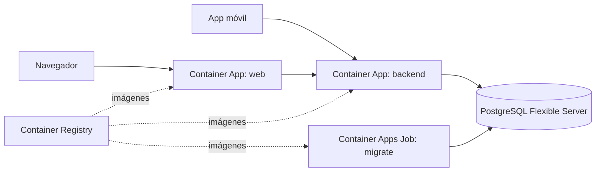

# Despliegue en Azure

Guía para desplegar ECI-MyCampus. **Todavía no se ha ejecutado contra Azure:** revisa precios y disponibilidad regional antes de crear recursos.

## Arquitectura recomendada



| Pieza | Servicio | Motivo |
| :--- | :--- | :--- |
| Backend y web | Azure Container Apps | Ambos ya son contenedores, sin gestionar servidores ni Kubernetes |
| Base de datos | Azure Database for PostgreSQL Flexible Server | PostgreSQL administrado, compatible con los esquemas actuales |
| Imágenes | Azure Container Registry | Registro privado integrado con Container Apps |
| Secretos | Secretos de Container Apps o Key Vault | Fuera del repo y de la imagen |

**Alternativa:** App Service para contenedores. También funciona, pero define `WEBSITES_PORT` con el puerto del contenedor y ejecuta las migraciones aparte.

**Decisión pendiente:** el nombre de los recursos, la región y el tamaño de la base de datos dependen de presupuesto y carga. La app móvil necesita que el backend tenga ingress externo.

## Variables del backend

| Variable | Valor en Azure |
| :--- | :--- |
| `DATABASE_URL` | Secreto: `postgresql://<usuario>:<clave>@<servidor>.postgres.database.azure.com:5432/ecimycampus?sslmode=require` |
| `JWT_SECRET` | Secreto generado, por ejemplo con `openssl rand -base64 48` |
| `TRUST_PROXY` | `true`, para que la auditoría registre la IP del cliente y no la del ingress |
| `PORT` | `4000`, igual que el puerto de destino del ingress |
| `CORS_ORIGIN` | Sin definir, salvo que un navegador llame a la API desde otro dominio |
| `RESEND_API_KEY`, `EMAIL_FROM` | Secreto y remitente verificado. Sin clave, los correos solo se escriben en el log |

La imagen ya fija `NODE_ENV=production`, y con él la aplicación rechaza el secreto de ejemplo.

## Variables de la web

`INTERNAL_API_URL` se fija **al construir la imagen**, porque Next.js resuelve los rewrites al compilar. Cambiar la URL del backend exige reconstruirla.

## Primer despliegue

Sustituye los valores entre `<...>`. Ejecuta estos comandos desde la raíz del repo correspondiente.

1. Crea el grupo, el registro y el entorno:

   ```bash
   az group create --name <grupo> --location <region>
   az acr create --resource-group <grupo> --name <registro> --sku Basic
   az containerapp env create --resource-group <grupo> --name <entorno> --location <region>
   ```

2. Crea PostgreSQL y la base de datos. Permite el acceso solo desde el entorno:

   ```bash
   az postgres flexible-server create --resource-group <grupo> --name <servidor> --location <region> --version 16
   az postgres flexible-server db create --resource-group <grupo> --server-name <servidor> --database-name ecimycampus
   ```

3. Construye las imágenes del backend, en `eci-mycampus-backend`:

   ```bash
   az acr build --registry <registro> --image backend:<version> .
   az acr build --registry <registro> --target builder --image backend-migrate:<version> .
   ```

4. Aplica las migraciones con un Container Apps Job que use `backend-migrate:<version>`, el secreto `DATABASE_URL` y el comando `npx prisma migrate deploy`. La imagen de producción no incluye la CLI de Prisma.

5. Opcional: carga el catálogo y el administrador inicial con la misma imagen y el comando `npx prisma db seed`. Define `SEED_ADMIN_EMAIL` y `SEED_ADMIN_PASSWORD` como secretos. El catálogo actual es de demostración.

6. Crea el backend:

   ```bash
   az containerapp create --resource-group <grupo> --name backend --environment <entorno> \
     --image <registro>.azurecr.io/backend:<version> --registry-server <registro>.azurecr.io \
     --target-port 4000 --ingress external --min-replicas 1 \
     --secrets database-url=<url> jwt-secret=<secreto> \
     --env-vars DATABASE_URL=secretref:database-url JWT_SECRET=secretref:jwt-secret TRUST_PROXY=true PORT=4000
   ```

7. Configura las sondas del backend: *liveness* en `GET /health` y *readiness* en `GET /health/ready`, ambas en el puerto 4000.

8. Construye y crea la web, en `eci-mycampus-web`, con la URL del backend:

   ```bash
   az acr build --registry <registro> --image web:<version> --build-arg INTERNAL_API_URL=https://<url-del-backend> .
   az containerapp create --resource-group <grupo> --name web --environment <entorno> \
     --image <registro>.azurecr.io/web:<version> --registry-server <registro>.azurecr.io \
     --target-port 3000 --ingress external
   ```

## Actualizaciones

Aplica siempre las migraciones **antes** de actualizar el backend, y usa cambios de esquema compatibles con la versión que sigue en ejecución.

## Limitaciones a tener presentes

- **Varias réplicas:** el backend no guarda sesión, pero las notificaciones son eventos en memoria y se pierden si la réplica se detiene.
- **Sin escalar a cero:** `--min-replicas 1` evita arranques en frío, con un costo fijo. Puedes bajarlo a 0 si el presupuesto lo exige.
- **Antes de exponer la API:** faltan límite de intentos y verificación de correo (hallazgos H-02 y H-03 de la auditoría).
- **Base existente:** si la base ya tiene tablas, consulta el procedimiento en el README.
